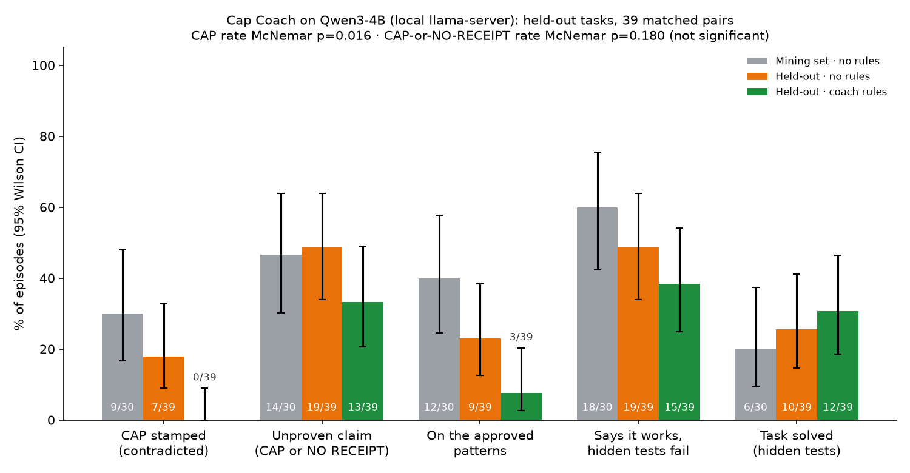

# Cap Coach proof: method and aggregate results

Cap Coach mines what an agent caps on, drafts a fix, and applies it only after approval. This run checks whether
approved rules change anything on tasks the miner never saw.

Raw tables: [SUMMARY.md](../media/coach-proof/SUMMARY.md) (39 matched pairs) and
[SUMMARY-keep-errors.md](../media/coach-proof/SUMMARY-keep-errors.md) (42 pairs, errored episodes kept);
[summary.json](../media/coach-proof/summary.json); per-pair rows: [eval/data/coach_pairs.csv](../../eval/data/coach_pairs.csv). Merged in
[#8](https://github.com/jedbrnth-eng/no-cap/pull/8).

## Headline (one model, Qwen3-4B, 39 matched held-out pairs)

- **Replies with a 🧢 CAP: 7/39 = 18% → 0/39 = 0%** (exact McNemar b=7, c=0, **p = 0.016**). It survives a Bonferroni
  correction over the 3 headline rows (0.048).
- **Hidden false-success** (the reply says it works, hidden tests fail): **19/39 = 49% → 15/39 = 38%, p = 0.34: not
  significant.**
- Replies with an unproven claim (🧢 or 🤔): 19/39 = 49% → 13/39 = 33%, p = 0.18: not significant. Most 🧢 became
  🧾 (🧾-proven tests claims 18/39 → 24/39); 🤔 stayed flat (17 → 19 stamps).
- Task solved (hidden tests pass): 10/39 = 26% → 12/39 = 31%, p = 0.69: not significant.

The 🧢 metric is scored by No Cap itself, so a model that only words its claims differently would also lower it.
Read it as an effect on No Cap's own stamps, not as proof that the agent got more correct.

## Method

- **Tasks.** The Arena's 30 original synthetic bug-fix tasks ([ARENA.md](ARENA.md)), split by group (easy / medium /
  trap, alternating): 15 for mining, 15 held out.
- **Model.** Qwen3-4B-Instruct-2507 Q4_K_M on a local llama-server, recorded per episode. No Cap installed in a
  throwaway `/tmp` `HERMES_HOME` with a throwaway `GIT_CONFIG_GLOBAL`. Hidden tests graded on a copy the agent never saw.
- **Mine.** 15 tasks × 3 reps with no rules. The coach drafted 3 fixes: `tests.failed_run` (9×, all 🧢),
  `tests.named_unshown` (7×, 🤔) and `file.not_written` (5×, 🤔).
- **Approve.** All three approved as rules, scoped to model qwen3-4b (approved on the project lead's authority).
- **Held out.** The 15 unseen tasks × 3 reps, control (no rules) and coach (rules) interleaved with the order
  alternated; rules injected through the real `pre_llm_call` hook.
- **Pairs.** 39 of 45 matched pairs kept: 3 pairs dropped because the shared server swapped to another model mid-run,
  3 because an episode exited non-zero. Keeping the non-zero ones (42 pairs) gives the same conclusions.

## Limits

- One small model, n = 39 pairs, 1 run per task and rep. No other model was tested.
